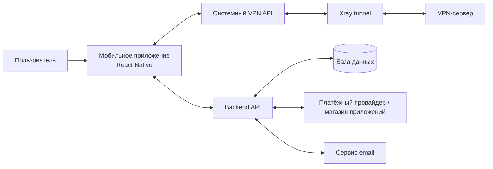
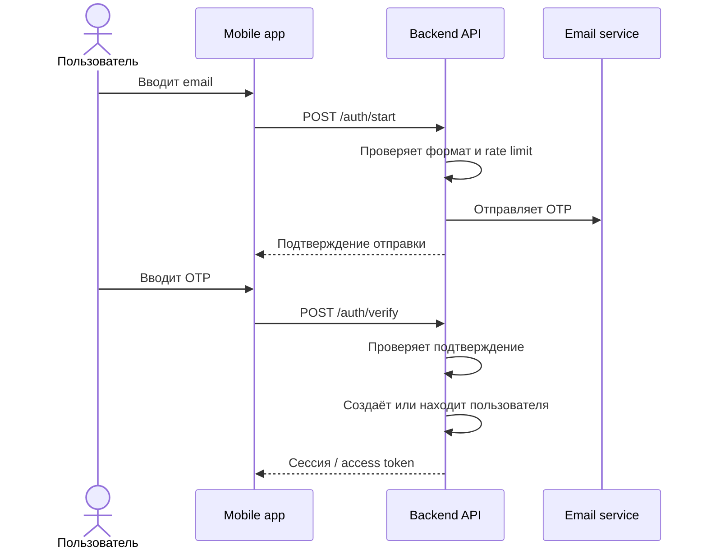
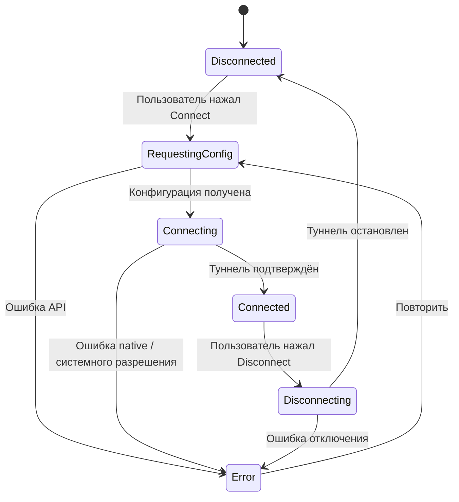

# 9. Diagrams

Диаграммы ниже — черновые модели, предназначенные для обсуждения.

## 9.1 Контекст системы

## 9.2 Вход по email

## 9.3 Подключение к VPN

## 9.4 Примечания

- Схемы не фиксируют окончательный способ выдачи конфигурации и хранения ключей.
- Точный жизненный цикл туннеля зависит от платформы и должен быть проверен прототипом.
- Платёжный провайдер и требования магазинов приложений не выбраны.
